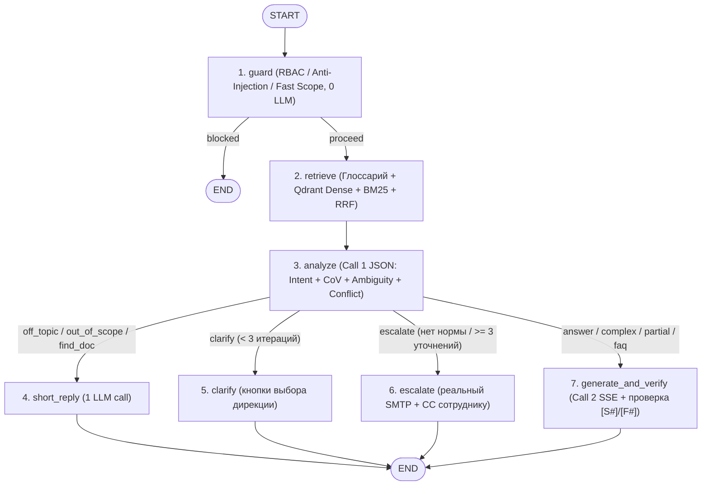

# ИИ-агент поиска ответов по корпоративным документам (Софтлайн · ИИКузница)

Прототип автономного многошагового ИИ-агента для Службы качества ПАО «Софтлайн», реализующий замкнутый цикл работы с корпоративными знаниями:
**гибридный поиск → разрешение неоднозначности (уточнение до 3 итераций / разделение дирекций) → подтверждённый ответ со ссылками на пункты ИЛИ реальная эскалация по Email в Службу качества → автоматическое чтение ответа эксперта из почты → пополнение проверенной базы знаний (FAQ) и повторное использование**.

---

## 1. Ключевые возможности (все 3 обязательных кейса + аналитика + RBAC)

- **Кейс 1 (Точный ответ без галлюцинаций):** гибридный поиск (`Qdrant Dense + BM25 + RRF`) с расширением терминов по официальному глоссарию (48 корпоративных аббревиатур) и иерархическим Parent-Child чанкингом `.docx` (611 пунктов с сохранением соседних подпунктов раздела, примечаний «Важно:» и таблиц в Markdown). Интерактивные кликабельные цитаты `[S1]` прямо в тексте ответа открывают оригинальный текст пункта в боковой шторке и ведут на точный пункт в полнотекстовом обозревателе «База регламентов».
- **Кейс 2 (Уточняющий диалог до 3 итераций и комплексные проекты):** условный граф `LangGraph` выявляет различия между ДБРЦТ, Технической дирекцией и Дирекцией ИБ, задаёт уточняющий вопрос с кнопками-вариантами и жёстким предохранителем **максимум 3 итерации** (после 3-й нерешённой итерации автоматически эскалирует в Службу качества). Для комплексных проектов выполняет раздельный per-directorate поиск и выводит требования каждой дирекции отдельными блоками без усреднения сроков и исключений (включая оговорку RFI).
- **Кейс 3 (Human-in-the-Loop через реальный Email SMTP + IMAP):** при отсутствии прямой нормы в регламентах агент программно блокирует домысливание (`Chain-of-Verification guardrail`), отправляет реальное SMTP-письмо в Службу качества (`quality@corp.local`) с сотрудником в копии (`CC`), присваивает тикет `[QA-2026-XXXX]` и сохраняет `Message-ID`. Фоновый IMAP-воркер (polling каждые 10 сек + автообновление в чате + кнопка ручной синхронизации) проверяет `whitelist` уполномоченных адресов Службы качества (отклоняя и логируя посторонних в журнал безопасности), связывает тред по `In-Reply-To`/`References`/`[QA-...]`, очищает ответ от цитирования и подписей (`email-reply-parser` + RU-фильтры Roundcube) и индексирует разъяснение в коллекцию `quality_faq_verified` с дедупликацией по тикету.
- **Приоритет источников, приватность 1-на-1 и модель прав (RBAC):**
  - **Приватный чат 1-на-1:** диалоги сотрудников изолированы по идентификатору сессии клиента (`X-Client-Id`) — пользователи не видят и не могут удалить чужие диалоги.
  - **Разграничение ролей:** роль **«Сотрудник»** имеет доступ только на чтение БЗ; загрузка новых `.docx` (с контролем лимита 5 МБ) и управление статусами FAQ защищены заголовком `X-Quality-Key` роли **«Служба качества»** (демо-ключ для жюри в шапке UI: `Quality2026`) и email-whitelist.
  - **Приоритет регламента над FAQ:** официальный регламент (`priority_rank=1`, read-only для агента) всегда имеет высший приоритет над FAQ (`priority_rank=2`); при расхождении агент опирается на официальный регламент и выводит предупреждение о конфликте источников (`has_conflict=true`).
- **Прозрачная агентность и готовность к DION:** каждый ответ содержит сворачиваемую трассировку узлов `LangGraph` (`trace` с таймингами и счётчиком верифицированных цитат), а синхронный REST endpoint `POST /api/chat` (Swagger `/docs`) готов к подключению корпоративного бота DION.
- **Центр Службы качества и Аналитика:** KPI обращений, графики распределения исходов и дирекций, интерактивный калькулятор бизнес-ROI (сэкономленные человеко-часы), журнал тикетов Email HITL, аудит безопасности (whitelist/RBAC), управление проверенной БЗ (FAQ), сигналы на пересмотр регламентов с выгрузкой отчёта (`.md`) и горячая загрузка новых `.docx` без перезапуска.

---

## 2. Архитектура 7-узлового графа `LangGraph` (`StateGraph`)



> **Строго ≤ 2 вызовов LLM на запрос:**
> - На ветках `guard` — **0 вызовов LLM** (~5 мс).
> - На ветках `short_reply`, `clarify`, `escalate` — **1 вызов LLM** (~2.5–3.5 сек).
> - На ветке полного ответа `generate_and_verify` — **2 вызова LLM** (первые токены в SSE-стриме через ~3 сек, полный развёрнутый ответ со ссылками за ~6–9 сек; валидация цитат программная за 0 мс).

---

## 3. Используемые Open-Weight модели (Apache 2.0, ≤ 128 ГБ VRAM)

Все модели — **Open-Weight с открытой лицензией Apache 2.0**, пригодные для 100% локального развёртывания в закрытом контуре компании (укладываются в 1×GPU 24–48 ГБ VRAM в Q4/FP8):

| Роль | Модель | Лицензия | Карточка Hugging Face | VRAM (локально Q4 / BF16) |
| --- | --- | --- | --- | --- |
| **LLM (маршрутизация + генерация)** | `Qwen/Qwen3-30B-A3B-Instruct-2507` (MoE, 30B всего / 3B активных, без thinking-режима) | **Apache 2.0** | https://huggingface.co/Qwen/Qwen3-30B-A3B-Instruct-2507 | ~18–20 ГБ (Q4) / ~60 ГБ (BF16) |
| **Embeddings** | `Qwen/Qwen3-Embedding-4B` (2560 dim, контекст 32k) | **Apache 2.0** | https://huggingface.co/Qwen/Qwen3-Embedding-4B | ~3–4 ГБ (Q4) / ~8 ГБ (BF16) |

---

## 4. Стек, демо-доступы и запуск

- **Оркестрация агента:** `LangGraph` (`StateGraph` с `add_conditional_edges`) + `Pydantic` structured outputs.
- **Векторная БД и гибридный поиск:** `Qdrant` (коллекции `regulations_official` и `quality_faq_verified`) + `BM25` (`rank-bm25`) + RRF.
- **Хранилище и аналитика:** `SQLite` (WAL mode) — изолированные сессии (`X-Client-Id`), сообщения, тикеты, FAQ, аналитика, аудит безопасности и учёт токенов.
- **Почтовый контур:** `Poste.io` (реальный SMTP 587 STARTTLS + IMAP 993 SSL + Roundcube Webmail в одном контейнере) + `aiosmtplib` + `imaplib` + `email-reply-parser`.
- **Backend / Frontend:** `FastAPI` (SSE streaming + REST `/api/chat`) + `React 18 / Vite / Tailwind CSS` + `Caddy` (авто-HTTPS).

### Демо-доступы на публичном стенде
- **Публичный стенд (HTTPS):** `https://139-100-218-28.sslip.io` (резервный HTTP: `http://139.100.218.28`)
- **Веб-почта Roundcube (для проверки Кейса 3):** `https://139-100-218-28.sslip.io/webmail/`
  - Ящик эксперта Службы качества (в whitelist): `quality@corp.local` / `QualityPass2026!`
  - Ящик сотрудника (получает копию `CC`): `employee@corp.local` / `EmployeePass2026!`
- **Ключ переключения роли «Служба качества» в UI:** `Quality2026` (или кнопка входа в 1 клик в модальном окне роли).

### 4.1. Стандартный запуск (Docker Compose)

```bash
cp .env.example .env
# Заполните LLM_API_KEY в .env
docker compose up -d --build
```

### 4.2. Полностью локальный запуск в изолированном контуре (GPU, `--profile local`)

```bash
docker compose --profile local up -d
docker compose exec ollama ollama pull qwen3:30b-a3b
docker compose exec ollama ollama pull qwen3-embedding:4b
```

В `.env`:
```env
LLM_BASE_URL=http://ollama:11434/v1
LLM_API_KEY=ollama
LLM_MODEL=qwen3:30b-a3b
EMBEDDING_MODEL=qwen3-embedding:4b
```

### 4.3. Автоматические тесты (18 сценариев: ловушки регламентов, лимит 3 уточнений, конфликт регламент > FAQ, RBAC, приватность)

```bash
docker compose exec app python tests/test_traps.py
```
